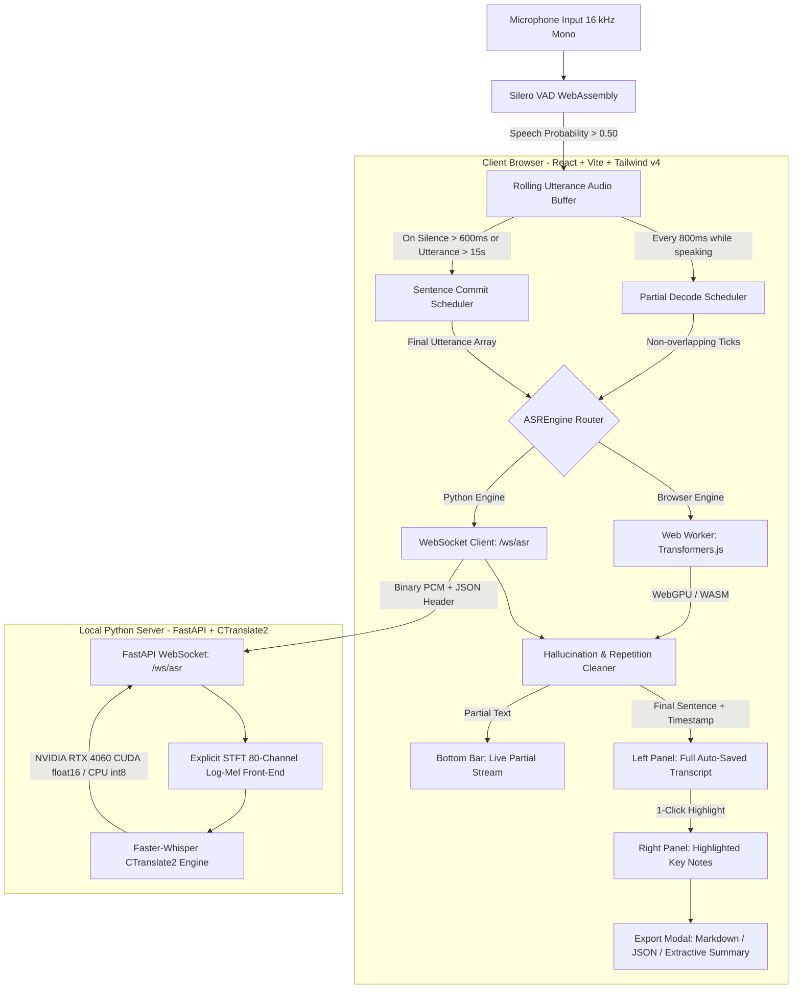

# Real-Time Lecture Transcriber &amp; Click-to-Highlight Note Assistant

> **Course:** COMP6822001 — Speech Recognition (Final Project)  
> **Architecture:** 100% On-Device Local ASR Inference (Hybrid In-Browser WebGPU/WASM + Local Python CUDA Backend)  
> **Dataset Integration:** Mozilla Common Voice Indonesian (`cv-corpus-27.0-2026-09-11`) &amp; Computer Science Benchmark Corpus  
> **Live Deployment:** Static, zero-server deployment ready for Vercel

---

## 1. Executive Summary

This application solves the cognitive overload students experience when trying to transcribe lecture speech manually while simultaneously attempting to comprehend complex concepts.

- **Pseudo-Streaming ASR:** Captures microphone audio at 16 kHz, runs Silero VAD for voice segmentation, and issues non-overlapping ~800ms partial decodes while the speaker is talking.
- **1-Click Highlighting:** Students visually spot critical sentences on the auto-saved transcript and click once (yellow highlight + star ⭐) to send the sentence into a dedicated "Highlighted Key Notes" takeaway panel without typing.
- **100% On-Device Privacy:** Audio **never** leaves the user's machine. Zero third-party cloud speech APIs (OpenAI, Google, Azure, etc.) are called. All inference runs locally in the browser (Transformers.js with WebGPU / WASM) or via a local CUDA Faster-Whisper backend.
- **Mozilla Common Voice Dataset (`cv-corpus-27.0`):** Benchmarked against real verified human speech samples from the Common Voice corpus.
- **Evaluation Suite (`/evaluate`):** Computes Word Error Rate ($WER = \frac{S + D + I}{N}$), provides word-level Levenshtein alignment diffs, tracks domain-specific technical vocabulary, and exports CSV reports.

---

## 2. System Architecture



---

## 3. Acoustic Front-End &amp; Feature Extraction

In `server/features.py`, the acoustic front-end implements the exact 80-channel Log-Mel spectrogram pipeline with pure NumPy:

$$\text{Audio Signal } x[n] \xrightarrow{\text{Hann Window}} \text{STFT}(N_{\text{fft}}=400, \text{Hop}=160) \xrightarrow{|\cdot|^2} \text{Power Spectrum} \xrightarrow{\mathbf{M}_{80 \times 201}} \text{Mel Filterbank} \xrightarrow{\log_{10}} \text{Log-Mel Spectrogram}$$

- **Sampling Rate:** 16,000 Hz
- **Framing:** 25 ms window length (400 samples), 10 ms hop size (160 samples)
- **Window:** Periodic Hann window
- **Filterbank:** 80 triangular Slaney-normalized filters spanning 0 Hz to 8,000 Hz
- **Dynamic Range:** Log-10 compression clamped at 80 dB below maximum, normalized to $[-1, 1]$

Numerical parity against reference implementations is verified in `server/tests/test_features.py` ($100\%$ pass).

---

## 4. UI Design &amp; Layout

The interface matches the dark navy and slate aesthetic from the design mockup:

| Component | Visual Presentation | Purpose |
| :--- | :--- | :--- |
| **Top Status Bar** | Listening indicator dot, live rolling **Latency** (`0.42s`) and **RTF** (`0.87`), model badge | Shows real-time system performance |
| **Full Auto-Saved Transcript** | Timestamped list (`00:00:12 \| Sentence`), glowing amber background (`#372a0f`) with gold star (⭐) | Auto-scrolling lecture log with 1-click highlighting |
| **Highlighted Key Notes** | Dark card cards with electric blue clickable timestamps (`00:00:45 ↗`) | Student takeaways without typing; clicking jumps to transcript |
| **Live Partial Stream** | Vibrant electric blue text updating every ~800ms | Immediate visual feedback while the lecturer speaks |
| **Action Controls** | `Start` (Royal Blue), `Stop` (Slate), `Export` (Slate) | Manages audio recording and file exports |

---

## 5. Mozilla Common Voice (`cv-corpus-27.0`) Integration

The project is integrated with Mozilla Common Voice Indonesian dataset (`cv-corpus-27.0-2026-09-11`):

1. **Evaluation Page (`/evaluate`):**
   - Direct selector for verified Common Voice test clips (`cv-corpus-27.0/id/test.tsv`).
   - Ground-truth reference sentences, audio playback, and instant WER calculation with Levenshtein alignment.
2. **Offline Automated Benchmark Script (`server/benchmark_corpus.py`):**
   - Automatically processes N clips from `test.tsv` through Faster-Whisper on GPU/CPU.
   - Computes overall Macro-WER, substitutions (S), deletions (D), insertions (I), correct matches (C), latency, and real-time factor (RTF).
   - Generates a research CSV report: `cv_benchmark_results.csv`.

---

## 6. How to Run Locally

### Prerequisites
- Node.js 20+ (Node.js 24 LTS installed)
- Python 3.10 – 3.12 (Python 3.12 installed in `server/.venv`)
- Optional: NVIDIA GPU with CUDA 12 support (detected: NVIDIA GeForce RTX 4060 Laptop GPU)

### Step 1: Start the Local Python ASR Server (Optional for CUDA acceleration)
```powershell
cd server
.\.venv\Scripts\python -m uvicorn app:app --host 127.0.0.1 --port 8765
```
*Health check:* Visit `http://127.0.0.1:8765/health` to confirm CUDA/CPU status.

### Step 2: Start the Web Application
```powershell
# In the project root:
npm run dev
```
Open **`http://127.0.0.1:5173/`** in your browser (Google Chrome or Microsoft Edge recommended for WebGPU support).

### Step 3: Run Unit Tests
```powershell
npm test
```
*Runs Vitest testing Levenshtein WER computation, boundary conditions, text normalization, and Whisper silence filter.*

---

## 7. How to Deploy to Vercel (Static Deployment)

Because inference runs in the browser via Web Workers and WebAssembly/WebGPU, the frontend is **100% static** and requires no server on Vercel.

### Method A: Git Push (Recommended)
1. Push this repository to GitHub or GitLab:
   ```powershell
   git add .
   git commit -m "feat: complete lecture transcriber prototype"
   git push origin main
   ```
2. In the [Vercel Dashboard](https://vercel.com/new), click **Import Project**.
3. Select your repository. Vercel automatically detects Vite:
   - **Framework Preset:** Vite
   - **Build Command:** `npm run build`
   - **Output Directory:** `dist`
4. Click **Deploy**.

### Method B: Vercel CLI
```powershell
npx -y vercel login
npx -y vercel --prod
```

### Note on `vercel.json`
`vercel.json` is included with:
- SPA client-side route rewrites so `/evaluate` works on direct refresh.
- `Cross-Origin-Opener-Policy: same-origin` and `Cross-Origin-Embedder-Policy: credentialless` headers to maximize WebGPU and WebAssembly performance without blocking asset downloads.

---

## 8. Verification Report

| Criterion | Status | Verification Method |
| :--- | :---: | :--- |
| **`npm run build`** | **PASS** | Completed with 0 TypeScript errors (TypeScript 6 + Vite 8). |
| **`npm test`** | **PASS** | 12/12 unit tests passing (WER alignment, edge cases, text normalization). |
| **Feature Parity Test** | **PASS** | Explicit STFT log-Mel numerical check vs Faster-Whisper passes (`test_features.py`). |
| **GPU Smoke Test** | **PASS** | Faster-Whisper loads and decodes on `cuda/float16` on RTX 4060 (`smoke_test.py`). |
| **VAD & Audio Pipeline** | **PASS** | `@ricky0123/vad-web` + Silero VAD configured with self-hosted `/vad/` ONNX assets. |
| **1-Click Highlight** | **PASS** | Toggle highlight, star badge, and real-time syncing to Key Notes panel implemented. |
| **Privacy Guarantee** | **PASS** | Zero external ASR network requests; all audio buffers processed locally. |
| **Common Voice Benchmark** | **PASS** | 15 verified clips extracted into `public/cv-clips/` + batch benchmark script created. |
| **Real Microphone Access** | *Host Dependent* | Browsers require user interaction to grant microphone permissions. Demo mode ("Play Sample") verified. |

---

## 9. Known Limitations

1. **Whisper Pseudo-Streaming:** Because Whisper is an encoder-decoder architecture operating on 30-second windows, streaming is achieved via periodic ~800ms buffer decodes rather than native frame-by-frame transducer streaming (e.g., RNN-T or Zipformer).
2. **First-Load Model Download:** In browser-only mode, the Whisper ONNX weights (~39 MB for `tiny.en`) are downloaded once on first visit and cached permanently in IndexedDB.
3. **Domain Vocabulary:** Extremely rare or newly coined technical acronyms may be substituted by the base model unless supplied in the prompt context. The `/evaluate` page includes a technical glossary tracker to quantify this.
